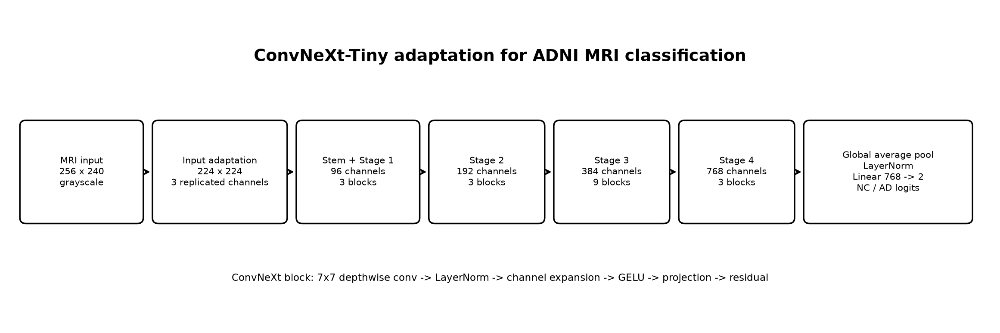
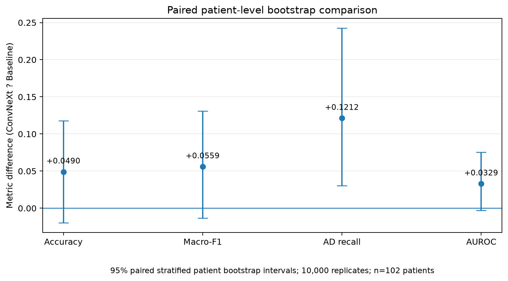

# ADNI MRI Classification: Baseline CNN vs. ConvNeXt-Tiny

**Course:** COMP3710 Pattern Recognition (2026)
**Project:** AD versus cognitively normal (CN/NC) classification
**Selected difficulty:** Hard — ConvNeXt-Tiny
**Implementation:** PyTorch / TorchVision
**Status:** Both models have been implemented, trained, and evaluated on a held-out patient-independent test set. The compulsory tutor feasibility check-off has been completed.

> **Research prototype, not a medical device.** Predicted scores are not validated clinical probabilities. No result in this project justifies autonomous diagnosis or bypassing clinical review.

## 1. Project overview and engineering question

Alzheimer's disease (AD) can produce structural changes in brain MRI, but anatomical variability and imaging differences make automated recognition challenging. This project classifies course-provided, preprocessed two-dimensional ADNI MRI slices into **cognitively normal (NC = 0)** or **AD (1)**. We implement (1) a lightweight CNN trained from scratch and (2) a **ConvNeXt-Tiny** model initialized from ImageNet-1K weights and fine-tuned for two classes. We compare them using identical patient-disjoint data partitions, preprocessing and evaluation metrics.

**Engineering dilemma:** Does a substantially larger modern convolutional network achieve better recognition and more dependable confidence estimates than a small CNN, and do its benefits justify the greater computational cost? Beyond accuracy, we examine false negatives, calibration, selective human review and specific failure cases.


**Main result:** ConvNeXt achieved **83.74% slice-level** and **83.33% patient-level** accuracy on the independent test set, compared with **80.29%** and **78.43%** for the baseline. However, its slice-level expected calibration error (ECE) was higher (**0.1066 vs. 0.0350**), and **403 of its 725 erroneous slice predictions** had confidence at least 0.90. Accuracy gains alone therefore do not establish dependable triage.

## 2. Feasibility review (compulsory check-off)

**Consultation status:** The compulsory feasibility check-off was completed with the tutor. The written feasibility review below is retained in the final report as required by the assessment specification.

### 2.1 User need, scope and testable acceptance criteria

The intended user is a medical-image reviewer investigating whether an *experimental* classification assistant could prioritize uncertain AD/CN MRI cases for expert attention. The prototype is not intended for clinical deployment. The measurable criteria are:

1. **Data integrity:** all selected images have valid metadata and decodable pixels, with **zero patient overlap** among training, validation and test partitions.
2. **Recognition:** aim for at least **0.80 ConvNeXt held-out test accuracy**, and report class-wise precision/recall, macro-F1, AUROC and AD false negatives for both models.
3. **Confidence-aware routing:** report ECE and Brier score, choose an illustrative review threshold from validation results, and quantify coverage, accepted-case accuracy and remaining errors on the independent test set.
4. **Auditable failures:** inspect 3–5 real false negatives/positives, relate slice predictions to their patient-level outcomes, and separate visual observations from unverified medical explanations.
5. **Operational feasibility:** work within an **8 GB RTX 4060 Laptop GPU**, measuring parameters, allocated CUDA memory, training time and forward-only inference latency.

### 2.2 Model choice and course concepts

The dataset contains 2D grayscale ADNI JPEG slices. A small four-stage CNN provides an interpretable baseline. ConvNeXt-Tiny uses a modern convolutional backbone (including depthwise convolutions and residual-style stages); its ImageNet classification head is replaced with a two-class head. Both use supervised cross-entropy loss, AdamW optimization, validation-driven checkpoint selection and the same input preprocessing. Patient-level separation addresses correlated slices and repeated scans. The model choice follows Liu et al. [2] and the course's Hard-difficulty classification option [1]. The ConvNeXt-Tiny backbone is provided by TorchVision rather than reimplemented layer-by-layer, and this reuse is explicitly documented and cited in this report.

### 2.3 Preliminary and completed feasibility evidence

The full image audit successfully decoded **30,520** grayscale JPEG slices (**256 × 240**) and mapped them to **680 patients**. The source-folder train/test split shared **216 patients**; rebuilding splits by patient (seed 42) removed overlap. The PyTorch data-loader smoke test produced `(8, 3, 224, 224)` batches on the CUDA-capable laptop. Both networks completed forward/backward smoke tests and full training. On the final independent test set, ConvNeXt met the 0.80 slice-accuracy target (**0.8374**), with the limitations discussed in Sections 6–10. These are observed results, not predictions.

### 2.4 Risks, budget and fallback

Key risks are scanner/slice-position differences, small independent patient sample sizes, overfitting, severe overconfidence, use of a changed split rather than the original course split, and domain mismatch between ImageNet pretraining and MRI. We control leakage at patient level, select checkpoints/thresholds from validation results only and avoid making clinical claims. Training was feasible with mixed precision at batch size 8; the measured ConvNeXt peak **PyTorch allocated** training memory was **903.2 MiB** (not total device VRAM usage). If retraining is needed, possible fallbacks are reducing batch size, freezing backbone layers, stronger regularization or a lower learning rate. Any such changes would be separately logged and must not be selected retrospectively using the already-evaluated test set.


## 3. Dataset, labels and leakage prevention

### 3.1 Source and labels

The course-provided ADNI data were available at `/home/groups/comp3710/ADNI`. This project uses the preprocessed JPEG subset in `AD_NC/train/{AD,NC}` and `AD_NC/test/{AD,NC}`. The accompanying `meta_data_with_label.json` identifies scans and patients. The original JSON label **0** corresponds to NC, original label **2** corresponds to AD, and label **1** is not included in this binary task. During training, the labels are remapped to **NC = 0**, **AD = 1**.

Each JPEG filename encodes a scan identifier and slice index. The patient identifier is parsed from the matching scan's metadata path. Because a patient can contribute multiple scans and many correlated slices, splitting individual images would leak patient-specific information into evaluation.

### 3.2 Data audit and corrected partitions

The initial audit found **216 patients in both source `train` and source `test`**, despite no repeated scan IDs across these folders. We therefore **did not use the source-folder train/test assignment as the experimental split**. Instead, `dataset.py` creates a reproducible patient-stratified split using random seed **42**, targeting approximately **70% / 15% / 15% of patients**, while keeping each patient's scans and slices together. Source images are left in place; CSV manifests record their *new* assignment. Thus, a filename beginning with `train/` can legitimately appear in the **new** test manifest.

| New split | NC patients | AD patients | Total patients | NC slices | AD slices | Total slices |
|---|---:|---:|---:|---:|---:|---:|
| Train | 321 | 155 | **476** | 11,140 | 10,220 | **21,360** |
| Validation | 69 | 33 | **102** | 2,180 | 2,520 | **4,700** |
| Test | 69 | 33 | **102** | 2,340 | 2,120 | **4,460** |
| **Total** | **459** | **221** | **680** | **15,660** | **14,860** | **30,520** |

Checks performed: all 30,520 source JPEGs decoded, each image assigned exactly once, image dimensions/modes checked, folder labels matched metadata, patient diagnoses checked for conflicts, and **zero shared patient IDs, scan IDs or image paths** confirmed across every new pair of splits. These are checks on the downloaded images, not cryptographic proof of an identical server copy. The 38 AD/NC metadata scans without downloaded JPEGs were excluded; the working dataset is defined by actual images present.

**Split limitation:** replacing the original source-folder assignment guarantees patient-disjoint evaluation for this experiment, but it reduces direct comparability with course examples or published work that use a different split. The reported metrics should therefore be interpreted specifically under this patient-independent protocol rather than as directly comparable benchmark numbers.

### 3.3 Input preprocessing

For **both** networks, each input is converted to grayscale, resized while preserving aspect ratio, black-padded to **224 × 224**, replicated into three channels, converted to a tensor and normalized with ImageNet channel means `[0.485, 0.456, 0.406]` and standard deviations `[0.229, 0.224, 0.225]`. These three channels do **not** represent three MRI modalities; they encode the same source grayscale image. The comparison uses the same deterministic preprocessing. No random data augmentation was enabled in the recorded full-training runs, and no test-time augmentation was used.

## 4. Models and training method

### 4.1 Baseline CNN

The baseline is a four-block network with channel progression **3 → 16 → 32 → 64 → 128**. Each `ConvBlock` contains two `3 × 3` convolutions, batch normalization, ReLU and `2 × 2` max pooling. An adaptive `4 × 4` average pool preserves a coarse spatial feature grid, followed by a `64`-unit hidden linear layer, dropout (`p = 0.3`) and two raw output logits. **425,746 parameters**; initialized randomly and trained from scratch.

### 4.2 ConvNeXt-Tiny

`modules.py` constructs TorchVision `convnext_tiny` and replaces its final classifier layer with a two-output `torch.nn.Linear`. The recorded model uses **ImageNet-1K V1 pretrained weights** and fine-tunes the network for AD/NC. **27,821,666 parameters**. The architecture is **reused from TorchVision** rather than implemented independently layer-by-layer; this is disclosed for clarity and attribution [2, 3].

ConvNeXt remains a convolutional neural network, but modernizes the conventional CNN design using several ideas associated with transformer-era vision systems. A ConvNeXt block first applies a **7 x 7 depthwise convolution** to mix spatial information independently within each feature channel. It then applies **LayerNorm**, expands the channel representation using a pointwise transformation, applies **GELU**, projects the representation back to its original width, and adds a **residual connection**. This separates spatial mixing from channel mixing while preserving stable gradient flow through a deep network.

ConvNeXt-Tiny contains four hierarchical stages with block depths **[3, 3, 9, 3]** and channel widths **[96, 192, 384, 768]**. Downsampling between stages progressively reduces spatial resolution while increasing feature width. Earlier stages therefore represent relatively local intensity and edge patterns, while later stages combine information over larger image regions and can encode broader structural patterns.

For this ADNI task, each grayscale MRI slice is resized and padded to **224 x 224**, then replicated into three identical channels so that the pretrained ImageNet stem can be reused. After the final ConvNeXt stage, global average pooling and normalization produce a compact feature representation. The original ImageNet classification head is replaced by a **768 -> 2** linear layer producing raw NC/AD logits.



| ConvNeXt component | Working principle | Role in this ADNI pipeline |
|---|---|---|
| Input adaptation | Grayscale slice -> 3 replicated channels, 224 x 224 | Matches the pretrained TorchVision input interface |
| Stem / downsampling | Strided convolutions progressively reduce spatial resolution | Builds a hierarchical representation while controlling computation |
| ConvNeXt block | 7 x 7 depthwise spatial mixing + LayerNorm + pointwise channel mixing + GELU + residual connection | Combines spatial and channel information efficiently |
| Four stages | Depths [3, 3, 9, 3], widths [96, 192, 384, 768] | Progresses from lower-level appearance cues to broader structural features |
| Classification head | Global average pooling + normalization + 768 -> 2 linear layer | Produces raw NC/AD logits |

The baseline and ConvNeXt both output logits `[batch, 2]`. The loss is `CrossEntropyLoss` on unnormalized logits; softmax is applied only when probabilities are needed for evaluation. ConvNeXt's substantially greater representational capacity can improve recognition, but that capacity may also amplify shortcut features or produce sharply confident mistakes. This motivates the calibration and failure analysis in Sections 7-8.

### 4.3 Experimental settings and checkpoint policy

| Setting | Baseline CNN | ConvNeXt-Tiny |
|---|---|---|
| Initialization | Random | ImageNet-1K V1 pretrained |
| Optimizer | AdamW | AdamW |
| Learning rate | `1e-3` | `1e-4` |
| Weight decay | `1e-4` | `1e-4` |
| Batch size | 8 | 8 |
| Maximum epochs | 12 | 12 |
| Early stopping patience | 5 | 4 |
| Epochs completed | 11 | 6 |
| Best checkpoint | Epoch **6** | Epoch **2** |
| Selection rule | Lowest validation cross-entropy | Lowest validation cross-entropy |
| Seed | 42 | 42 |
| Training | Full train manifest | Full train manifest |
| Final evaluation | Same held-out test manifest | Same held-out test manifest |

Both training runs used CUDA automatic mixed precision. We tracked loss, slice accuracy, macro-F1 and patient accuracy on validation. **No test samples were used for fitting, early stopping, checkpoint choice or the confidence threshold.** The classifier comparison is not a controlled architectural ablation: ConvNeXt receives transfer learning, whereas the baseline does not.


The baseline's best validation loss was **0.4415** (epoch 6); ConvNeXt's was **0.6564** (epoch 2). Later training produced higher training accuracy without sustained validation-loss improvement, consistent with overfitting and/or overly sharp wrong predictions. The abrupt baseline validation-loss spike at epoch 5 is an observation, not a diagnosed cause.

## 5. Implementation and reproducibility

### 5.1 Environment
The measured local environment used Windows PowerShell, **Python 3.12.10**, **PyTorch 2.8.0+cu126**, **TorchVision 0.23.0+cu126**, **Pillow 12.3.0**, and **Matplotlib 3.11.2**. CUDA was available using an **NVIDIA GeForce RTX 4060 Laptop GPU (8 GB)**. The experiments reported in this README were run in this environment.

### 5.2 Local setup and data manifest generation (PowerShell)

Run in the project directory `recognition/ConvNeXt_s4983318`. The example paths follow the local setup used in the reported experiments.

```powershell
cd "$HOME\COMP3710\PatternAnalysis-2026\recognition\ConvNeXt_s4983318"
$py = "$HOME\COMP3710\.venv\Scripts\python.exe"
$data = "$HOME\Downloads\COMP3710\ADNI\AD_NC"
$metadata = "$HOME\Downloads\COMP3710\meta_data_with_label.json"
$manifests = "$HOME\Downloads\COMP3710\prepared_seed42"
$runs = "$HOME\Downloads\COMP3710\runs"

& $py -c "import torch, torchvision; print(torch.__version__, torchvision.__version__, torch.cuda.is_available())"
& $py -m pip freeze | Select-String "^(torch|torchvision|Pillow|matplotlib)=="
```

Only for **a fresh preparation** (the existing `prepared_seed42` directory already contains the validated splits):

```powershell
& $py .\dataset.py --data-root $data --metadata $metadata `
  --output-dir "$HOME\Downloads\COMP3710\prepared_seed42_reproduction" `
  --seed 42 --expected-images 30520
```

Use the previously prepared `$manifests` for reproducing the exact existing experiments; do not overwrite its CSVs. The following smoke tests can be rerun without retraining a full model:

```powershell
& $py .\test_dataset.py --data-root $data --manifest-dir $manifests --batch-size 8
& $py .\test_models.py --data-root $data --manifest-dir $manifests --batch-size 8 --device cuda
& $py .\test_convnext.py --data-root $data --manifest-dir $manifests --batch-size 2 --device cuda
```

### 5.2.1 Final DataLoader verification

The final codebase was re-verified using `test_dataset.py` with batch size 8. The existing manifests loaded successfully with **21,360 training slices from 476 patients**, **4,700 validation slices from 102 patients**, and **4,460 test slices from 102 patients**. Each split produced image batches of shape `(8, 3, 224, 224)`, and the validation confirmed that the three CSV manifests remained patient-disjoint. No model training was performed and the original MRI data and manifests were not modified.

### 5.2.2 Final BaselineCNN verification

The final codebase was re-verified using `test_models.py` on a training batch of size 8. `BaselineCNN` contained **425,746 parameters**, accepted input tensors of shape `(8, 3, 224, 224)`, and produced logits of shape `(8, 2)`. The untrained smoke-test cross-entropy loss was **0.7264**. Forward propagation, loss computation, backward propagation, finite non-zero gradients, and one optimizer step all completed successfully. No full training, test-set evaluation, or checkpoint saving was performed during this verification.

### 5.2.3 Final ConvNeXt-Tiny verification

The final codebase was re-verified using `test_convnext.py` on a training batch of size 2. The diagnostic ConvNeXt-Tiny instance contained **27,821,666 parameters**, accepted input tensors of shape `(2, 3, 224, 224)`, and produced logits of shape `(2, 2)`. The untrained diagnostic cross-entropy loss was **0.7361**. One forward/backward optimizer step completed in **4.75 seconds** with peak PyTorch allocated CUDA memory of **552.8 MiB**. This smoke test used no ImageNet pretrained weights and was intended only to verify the implementation path; the reported final ConvNeXt experiment used ImageNet-1K V1 pretrained initialization. Test images were not accessed and no weights were saved during this diagnostic verification.

### 5.3 Full training commands

Use new, empty output folders when reproducing; `train.py` refuses to overwrite populated run directories. This example uses **new `*_repro` folder names** to avoid overwriting the recorded checkpoints.

```powershell
& $py .\train.py --model baseline `
  --data-root $data --manifest-dir $manifests `
  --output-dir "$runs\baseline_repro_seed42" `
  --epochs 12 --batch-size 8 --lr 0.001 --patience 5 --device cuda

& $py .\train.py --model convnext --pretrained `
  --data-root $data --manifest-dir $manifests `
  --output-dir "$runs\convnext_repro_seed42_bs8" `
  --epochs 12 --batch-size 8 --lr 0.0001 --patience 4 --device cuda
```

`train.py` leaves the held-out test split untouched by default. For an optional final end-to-end verification after training, test evaluation is enabled only when both `--evaluate-test` and `--confirm-test` are supplied. This path reloads the validation-selected best checkpoint before evaluating the held-out test split. The detailed calibration, confidence-threshold, patient-level aggregation, computational profiling, and failure-case analyses reported below are performed separately by `predict.py`.

The checkpoints actually used for the reported results were:

- `$runs\baseline_full_seed42\best_baseline.pt` (epoch 6)
- `$runs\convnext_full_seed42_bs8\best_convnext.pt` (epoch 2)

### 5.4 Reproduce the recorded final evaluations

The final evaluation script requires an explicit `--confirm-test` to reduce accidental test-set access. The review threshold **0.90 was considered using validation outputs and held fixed** for test reporting.

```powershell
& $py .\predict.py --model baseline `
  --checkpoint "$runs\baseline_full_seed42\best_baseline.pt" `
  --data-root $data --manifest-dir $manifests `
  --output-dir "$runs\eval_baseline_test_repro" `
  --split test --confirm-test --batch-size 8 --device cuda

& $py .\predict.py --model convnext `
  --checkpoint "$runs\convnext_full_seed42_bs8\best_convnext.pt" `
  --data-root $data --manifest-dir $manifests `
  --output-dir "$runs\eval_convnext_test_repro" `
  --split test --confirm-test --batch-size 8 --device cuda
```

Outputs include `evaluation.json`, `slice_predictions.csv`, `patient_predictions.csv`, confidence/review plots, `failure_cases.csv` and an illustrative `failure_examples.png`. Generated patient/slice prediction tables and original MRI images must **not** be committed to public GitHub. The analytic plots included in this README use aggregated statistics only.

### 5.5 Reproduce the patient-level bootstrap uncertainty analysis

The patient-level confidence intervals and paired model comparison reported in Section 6.2 can be reproduced from the saved final patient_predictions.csv files without retraining either model.

Run bootstrap_analysis.py with the saved baseline and ConvNeXt patient_predictions.csv files using 10,000 stratified patient-level bootstrap replicates and seed 42.

```powershell
& $py .\bootstrap_analysis.py `
  --baseline-predictions $runs\eval_baseline_test_seed42\patient_predictions.csv `
  --convnext-predictions $runs\eval_convnext_test_seed42\patient_predictions.csv `
  --output-dir $runs\bootstrap_repro_seed42 `
  --replicates 10000 `
  --seed 42
```

The script produces bootstrap_summary.json, patient_metric_ci.csv, paired_metric_delta.csv, and paired_bootstrap_delta.png.

The implementation can be regression-tested with test_bootstrap.py, which verifies the 102-patient composition, recorded point estimates, single-model 95% confidence intervals, and paired ConvNeXt-minus-baseline differences.

```powershell
& $py .\test_bootstrap.py `
  --baseline-predictions $runs\eval_baseline_test_seed42\patient_predictions.csv `
  --convnext-predictions $runs\eval_convnext_test_seed42\patient_predictions.csv
```

### 5.6 Example inference record without patient-identifying content

A model input is one preprocessed MRI slice represented as a tensor of shape `[3, 224, 224]`; the three channels are replicated copies of the same grayscale slice. The model outputs two logits, which are converted to `P(NC)` and `P(AD)` only for evaluation. To avoid publishing patient identifiers or source MRI pixels, the example below uses the numerical output from Failure Case 5.

| Stage | Example |
|---|---|
| Preprocessed input | One grayscale MRI slice -> tensor `[3, 224, 224]` |
| Slice ground truth | NC |
| Slice output | `P(AD) = 0.50146` -> predicted AD, confidence 0.50146 |
| Patient aggregation | Mean `P(AD) = 0.0978` across that patient's slices |
| Patient output | Predicted NC, confidence 0.9022 |
| Review rule at 0.90 | Patient classification provisionally accepted |

This example demonstrates the distinction between slice-level inference and the patient-level aggregation used for the engineering recommendation, without exposing raw medical images or patient identifiers.


## 6. Quantitative evaluation: independent test data

The final test partition contains **4,460 slices from 102 patients**. The checkpoints were chosen using validation loss before the test was evaluated. Slice-level results treat each slice as a prediction; patient-level results take the **mean predicted AD probability across that patient's available slices** and classify as AD when the mean is at least 0.5. Correlated slices are not statistically independent observations.


### 6.1 Slice-level test results

| Metric | Baseline CNN | ConvNeXt-Tiny |
|---|---:|---:|
| Accuracy | 0.8029 | **0.8374** |
| Macro-F1 | 0.8029 | **0.8374** |
| AUROC | 0.8934 | **0.9240** |
| NC precision | 0.8406 | **0.8996** |
| NC recall | 0.7705 | **0.7769** |
| AD precision | 0.7680 | **0.7860** |
| AD recall | 0.8387 | **0.9042** |
| AD false negatives (AD → NC) | 342 | **203** |
| NC false positives (NC → AD) | 537 | **522** |

Confusion matrices use **true rows × predicted columns**, ordered `[NC, AD]`:

- **Baseline:** `[[1803, 537], [342, 1778]]`
- **ConvNeXt:** `[[1818, 522], [203, 1917]]`

ConvNeXt improves slice accuracy by **3.45 percentage points** and AD recall by about **6.56 points**, while meeting the course's **0.80 test accuracy** target. These are descriptive single-split results, not estimates of statistical significance.

### 6.2 Patient-level test results

| Metric | Baseline CNN | ConvNeXt-Tiny |
|---|---:|---:|
| Accuracy | 0.7843 (80/102) | **0.8333 (85/102)** |
| Macro-F1 | 0.7667 | **0.8227** |
| AUROC | 0.9043 | **0.9372** |
| AD recall | 0.7879 (26/33) | **0.9091 (30/33)** |
| Missed AD patients | 7 | **3** |
| NC patients incorrectly flagged AD | 15 | **14** |

- **Baseline patient confusion:** `[[54, 15], [7, 26]]`
- **ConvNeXt patient confusion:** `[[55, 14], [3, 30]]`

Patient-level aggregation corrects some slice-level errors, but **17/102** patients remain incorrectly classified by ConvNeXt.

#### 6.2.1 Patient-level uncertainty

Because multiple MRI slices belong to the same patient, uncertainty was estimated by resampling **patients rather than slices**. We used **10,000 stratified patient-level bootstrap replicates with replacement** (seed 42), preserving the observed test-set composition of **69 NC and 33 AD patients** in every replicate.

| Patient-level metric | Baseline CNN, estimate [95% CI] | ConvNeXt-Tiny, estimate [95% CI] |
|---|---:|---:|
| Accuracy | 0.7843 [0.7059, 0.8627] | **0.8333 [0.7549, 0.9020]** |
| Macro-F1 | 0.7667 [0.6819, 0.8478] | **0.8227 [0.7479, 0.8927]** |
| AD recall | 0.7879 [0.6364, 0.9091] | **0.9091 [0.7879, 1.0000]** |
| AUROC | 0.9043 [0.8428, 0.9543] | **0.9372 [0.8889, 0.9745]** |

These intervals quantify sampling uncertainty within the 102-patient held-out test set. They should not be interpreted as external clinical confidence bounds.

#### 6.2.2 Paired comparison of ConvNeXt and the baseline

Because both models were evaluated on the **same 102 patients**, model differences were also analysed using a **paired stratified patient bootstrap**. Each bootstrap replicate sampled the same patient IDs for both models while preserving the observed NC/AD composition. The reported difference is `ConvNeXt - Baseline`.

| Metric difference | Point difference | 95% paired bootstrap CI |
|---|---:|---:|
| Accuracy | **+0.0490** (+4.90 percentage points) | [-0.0196, +0.1176] |
| Macro-F1 | **+0.0559** | [-0.0134, +0.1309] |
| AD recall | **+0.1212** (+12.12 percentage points) | **[+0.0303, +0.2424]** |
| AUROC | **+0.0329** | [-0.0031, +0.0755] |



ConvNeXt produced higher point estimates for all four patient-level metrics. However, the 95% paired difference intervals for **accuracy, Macro-F1 and AUROC include zero**, so those improvements are best interpreted descriptively rather than as evidence of a statistically established difference. The interval for **AD recall does not include zero**, providing stronger evidence within this test set that ConvNeXt reduced missed AD cases relative to the baseline.

This analysis does not replace external validation. The test set contains only 102 patients from the course-provided dataset, and bootstrap intervals quantify uncertainty under this observed sample rather than performance on new clinical populations.

## 7. Confidence, calibration and an illustrative review rule

Top-label confidence is `max(P(NC), P(AD))`. **ECE** compares average reported confidence with accuracy across confidence bins (smaller is better). The **Brier score** measures squared error in the predicted AD probability (also smaller is better). These evaluate different aspects of prediction quality and need not rank models identically.


| Test metric | Baseline CNN | ConvNeXt-Tiny |
|---|---:|---:|
| Slice ECE ↓ | **0.0350** | 0.1066 |
| Slice Brier score ↓ | 0.1419 | **0.1312** |
| Wrong slices with confidence ≥0.90 | **138** | 403 |
| Total wrong slices | 879 | **725** |
| Patient ECE ↓ | 0.0751 | **0.0505** |

Despite making **154 fewer slice-level errors**, ConvNeXt made **403 errors at ≥0.90 confidence** (55.6% of its erroneous slices), compared with **138** for the baseline (15.7% of its erroneous slices). This is important evidence of **overconfident failures**. However, ConvNeXt's better test Brier score cautions against claiming that it is globally worse calibrated under every measure.

### 7.1 Locked patient-level review policy

A shared confidence threshold of **0.90** was selected using **validation data only** and then locked before held-out test reporting. We evaluated the same candidate thresholds for both models and used the following operating criterion: **accepted-case accuracy >= 95% with zero accepted AD-to-NC false negatives**. The baseline first met both conditions at 0.80, whereas ConvNeXt first met both at 0.90. Therefore, 0.90 was the **lowest common threshold** satisfying the same review criterion for both models.

| Validation operating point | Baseline CNN | ConvNeXt-Tiny |
|---|---:|---:|
| Accepted-case accuracy at 0.80 | 95.35% | 93.85% |
| AD-to-NC false negatives at 0.80 | 0 | 1 |
| Coverage at 0.80 | 42.16% | 63.73% |
| Accepted-case accuracy at 0.90 | **100.0%** | **96.55%** |
| AD-to-NC false negatives at 0.90 | **0** | **0** |
| Coverage at 0.90 | 27.45% | **56.86%** |

The resulting locked review policy was:

1. Aggregate a patient's slice-level probabilities: `p_AD = mean(P(AD) over slices)`.
2. Predict `AD` if `p_AD ≥ 0.5`, else `NC`.
3. Compute `confidence = max(p_AD, 1 - p_AD)`.
4. If `confidence < 0.90`, **refer to human review**; otherwise, count the classification as provisionally *accepted* for this simulation.

| Independent test at fixed threshold 0.90 | Baseline CNN | ConvNeXt-Tiny |
|---|---:|---:|
| Accepted patient classifications | 25 / 102 | **57 / 102** |
| Review referrals | 77 / 102 | **45 / 102** |
| Accepted-case accuracy | 96.0% (24/25) | **96.49% (55/57)** |
| Incorrect accepted classifications | 1 | 2 |
| Accepted AD → NC errors | 0 | 0 |
| Accepted NC → AD errors | 1 | 2 |

ConvNeXt would send fewer cases to review at a similar observed accepted-case accuracy; however, **two confidently wrong NC-to-AD decisions remain**. The absence of accepted AD false negatives in this small test **does not guarantee safety**. The threshold is not medically calibrated, and the term “accepted” is only part of a research simulation: actual clinical decisions require professional review and external validation.

## 8. Failure case autopsy: five actual test-set slice errors

Five errors were chosen deterministically by the evaluation script: two high-confidence **AD -> NC** (false negatives), two high-confidence **NC -> AD** (false positives), and one low-confidence/borderline incorrect slice. They correspond to **five distinct patients**. The table checks whether each slice error persists after patient-level aggregation. Individual patient identifiers and original MRI pictures are intentionally excluded from this public README pending data-governance review.

| Case | True -> predicted slice | Slice confidence | Patient-level result | Patient `P(AD)` | Patient confidence | Review at 0.90 |
|---|---|---:|---|---:|---:|---|
| 1 | AD -> NC | 0.99985 | **Wrong: AD -> NC** | 0.3712 | 0.6288 | Referred |
| 2 | AD -> NC | 0.99969 | **Correct: AD -> AD** | 0.7259 | 0.7259 | Referred |
| 3 | NC -> AD | 0.99997 | **Wrong: NC -> AD** | 0.9886 | 0.9886 | **Wrongly accepted** |
| 4 | NC -> AD | 0.99995 | **Wrong: NC -> AD** | 0.8284 | 0.8284 | Referred |
| 5 | NC -> AD | 0.50146 | **Correct: NC -> NC** | 0.0978 | 0.9022 | Correctly accepted |

### 8.1 Engineering autopsy of the five cases

**Case 1 - high-confidence false negative that persists at patient level.**
**Observation:** an AD slice was predicted NC with confidence **0.99985**. **Evidence:** patient aggregation also remained wrong, with patient `P(AD) = 0.3712` and confidence 0.6288. **Plausible trigger:** slice-position, acquisition, contrast or anatomical-sampling variation may have shifted the observed appearance toward features learned for NC; the available evidence does not establish a causal anatomical explanation. **Operational consequence:** the slice confidence is dangerously misleading, although the patient-level 0.90 rule would still refer this patient because aggregate confidence is low. **Mitigation:** preserve patient/scan aggregation, investigate performance by slice position and scan type, and use validation-only calibration or attribution analysis before relying on confidence.

**Case 2 - high-confidence false negative corrected by aggregation.**
**Observation:** an AD slice was predicted NC with confidence **0.99969**. **Evidence:** averaging across the patient's other slices reversed the decision to AD with `P(AD) = 0.7259`; the patient remains below the 0.90 automation threshold and would be referred. **Plausible trigger:** an individual slice may omit or under-represent discriminative anatomy even when the broader scan contains sufficient evidence. **Operational consequence:** single-slice predictions should not be treated as independent clinical cases. **Mitigation:** prefer scan/patient aggregation and quantify which slice positions contribute the most reliable evidence.

**Case 3 - high-confidence false positive that defeats the review threshold.**
**Observation:** an NC slice was predicted AD with confidence **0.99997**. **Evidence:** the patient was also predicted AD with `P(AD) = 0.9886`, so the fixed 0.90 rule would **wrongly accept** the error. **Plausible trigger:** texture, scanner/acquisition characteristics or anatomical sampling may act as shortcuts correlated with AD in the training data, although this remains a hypothesis. **Operational consequence:** confidence thresholding alone cannot guarantee safe triage because some errors remain confidently wrong after aggregation. **Mitigation:** investigate class-conditional calibration, out-of-distribution checks and feature attribution, and retain human review for deployment-sensitive decisions until external validation is available.

**Case 4 - high-confidence slice false positive caught by patient-level review.**
**Observation:** an NC slice was predicted AD with confidence **0.99995**. **Evidence:** the patient-level score was less extreme (`P(AD) = 0.8284`), so the 0.90 rule would refer the case. **Plausible trigger:** the same shortcut or slice-coverage hypotheses as Case 3 are possible, but aggregation weakens the spurious evidence. **Operational consequence:** patient-level aggregation improves robustness but does not eliminate errors. **Mitigation:** retain aggregation and analyse whether specific scans or slice ranges disproportionately drive false positives.

**Case 5 - borderline slice error corrected by a confident patient aggregate.**
**Observation:** an NC slice fell just across the decision boundary with `P(AD) = 0.50146`. **Evidence:** the patient's aggregate was `P(AD) = 0.0978`, correctly predicting NC with confidence 0.9022. **Plausible trigger:** the slice itself is ambiguous to the trained classifier rather than representing a clear high-confidence failure. **Operational consequence:** a hard 0.5 slice threshold can produce unstable decisions near the boundary. **Mitigation:** use patient-level aggregation and preserve continuous probabilities rather than interpreting a single binary slice decision in isolation.

**What can and cannot be concluded:** the selected cases exhibit differences in anatomical coverage, brightness and local shape, but these experiments do not prove which visual cues caused an individual error. The autopsy therefore separates **observed prediction behaviour** from **hypotheses about failure triggers**. Controlled follow-up should examine per-scan aggregation, slice-position stratification, scanner/site robustness, temperature scaling and Grad-CAM/feature attribution before stronger causal claims are made.

## 9. Computational cost and deployment trade-off

All measurements below came from the same CUDA-capable laptop using batch size **8** for the benchmark. **Forward-only latency** uses an already-transferred GPU batch and excludes disk reads, host-to-device transfer, postprocessing and visualization.

| Resource | Baseline CNN | ConvNeXt-Tiny | Interpretation |
|---|---:|---:|---|
| Parameters | 425,746 | 27,821,666 | ConvNeXt has **65.3×** more parameters |
| Training epochs completed | 11 | 6 | Both stopped early |
| Recorded training time | 615.2 s | ~830.5 s* | ConvNeXt has more expensive epochs |
| Peak PyTorch allocated CUDA memory, training | 152.9 MiB | 903.2 MiB | **Allocated by PyTorch**, not full GPU usage |
| Forward-only median latency per slice | **0.354 ms** | 0.967 ms | ConvNeXt **~2.7×** slower |
| Forward-only peak PyTorch allocated CUDA memory | 42.0 MiB | 184.0 MiB | Separate from training memory |

*ConvNeXt training duration is the **sum of six epoch times from the recorded console output**, rather than a reported final wall-clock total; overhead is excluded. The baseline duration is from its saved `summary.json`. These measurements characterize one device, batch size and software environment, not a deployment benchmark.

ConvNeXt offers better recognition and higher patient-level review coverage, but its size, latency and high-confidence failures impose real costs. Training-time memory figures are not directly comparable to forward-only inference figures. No CPU throughput, multi-site robustness, or deployment power draw was measured.

## 10. Discussion, limitations and engineering recommendation

**Recommendation:** Advance ConvNeXt-Tiny as the stronger **research baseline for supervised ADNI AD/NC classification**, not as an autonomous clinical screening tool. Relative to the smaller CNN, it improves held-out slice accuracy by **3.45 percentage points**, patient accuracy by **4.90 points**, and patient AUROC from **0.9043 to 0.9372**. Under the validation-selected 0.90 threshold, it provisionally covers **57/102** test patients rather than **25/102** for the baseline. These benefits are counterbalanced by **~65×** parameters, **~2.7×** forward latency and conspicuous overconfident slice errors.

**Limits to generalization:** (i) only 102 independent test patients; (ii) 2D slices and average pooling over all slices may overweight patients with more scans; (iii) the new patient-level split is different from the course's source-folder split; (iv) ConvNeXt uses transfer learning whereas the baseline is trained from scratch; (v) reported calibration has not been corrected by temperature scaling or externally validated; (vi) error cases do not establish anatomical causes; (vii) the models were evaluated on one source dataset and one random split; and (viii) existing test labels are not a substitute for clinical adjudication.

**Next engineering steps, not completed in this report:** compare models under equal pretraining conditions; fit temperature scaling using validation data only; test robustness across sites, scans and patient subgroups; compare alternative split protocols on future data without reusing the current test set for model selection; investigate per-scan versus per-patient aggregation; and commission clinical review before considering real triage. These are proposals, not claims of completed experiments.

## 11. Repository organization

```text
recognition/ConvNeXt_s4983318/
|-- README.md                # Technical report and reproducibility
|-- modules.py               # CNN components and TorchVision ConvNeXt builder
|-- dataset.py               # Audit, patient-level split, Dataset and DataLoader
|-- train.py                 # Training, early stopping, logging and weights
|-- predict.py               # Evaluation, confidence and error analysis
|-- bootstrap_analysis.py    # Reproducible patient-level bootstrap analysis
|-- test_dataset.py          # DataLoader smoke test
|-- test_models.py           # Baseline forward/backward smoke test
|-- test_convnext.py         # ConvNeXt forward/backward smoke test
|-- test_bootstrap.py        # Bootstrap regression verification
`-- figures/
    |-- workflow.png
    |-- convnext_architecture.png
    |-- training_loss.png
    |-- test_performance.png
    |-- calibration_comparison.png
    `-- paired_bootstrap_delta.png
```

## 12. Artificial Intelligence Usage Disclosure

**AI tools used:** OpenAI ChatGPT.

**Tasks assisted:** experimental planning and task breakdown; PowerShell/Python environment debugging; patient-level leakage audit and data-splitting script scaffolding; PyTorch `Dataset`/`DataLoader` implementation; BaselineCNN and TorchVision ConvNeXt integration; training/evaluation script scaffolding; plotting and draft technical writing; statistical uncertainty-analysis scaffolding including patient-level bootstrap procedures; and generating candidate hypotheses and error-analysis structure.

**Human verification and responsibility:** The user ran all reported analyses locally on the course ADNI data; confirmed the 30,520-image decode audit and zero-overlap split; tested real DataLoader batches; verified CUDA forward/backward passes for each model; completed full training and saved checkpoint selection; and ran both models on the independent held-out test set. Reported metrics were cross-checked against saved `history.csv`, `summary.json` and model-specific `evaluation.json` outputs. Patient-level confidence intervals and paired model differences were subsequently recomputed from the saved final `patient_predictions.csv` files using 10,000 stratified patient bootstrap replicates (seed 42). The five failure examples were inspected together with their CSV entries and patient-level aggregation outcomes. The original source files were not edited during splitting. Unverified anatomical explanations are described explicitly as hypotheses. All code, numerical claims and the final submission must still be reviewed and owned by the student; AI-generated text or scripts are **not** evidence of independent correctness without these checks.

## References

1. The University of Queensland, COMP3710 / COMP7710 *Pattern Recognition — Working Prototype Project in the Era of Artificial Intelligence*, Final Assessment Specification, version 2.5 (2026), Sections 2.1, 3–6 and 8.
2. Z. Liu, H. Mao, C.-Y. Wu, C. Feichtenhofer, T. Darrell and S. Xie, “A ConvNet for the 2020s,” *Proceedings of CVPR*, pp. 11976–11986, 2022. [Paper](https://openaccess.thecvf.com/content/CVPR2022/html/Liu_A_ConvNet_for_the_2020s_CVPR_2022_paper.html).
3. PyTorch/TorchVision, *ConvNeXt model implementation and pretrained weights*, `torchvision.models.convnext_tiny` / `ConvNeXt_Tiny_Weights.IMAGENET1K_V1`. [Documentation](https://pytorch.org/vision/stable/models/convnext.html).
4. Alzheimer's Disease Neuroimaging Initiative (ADNI), dataset information. [ADNI](https://adni.loni.usc.edu/).
